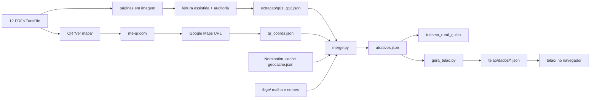

# ARCHITECTURE — como está construído hoje (16/10/2026)

Sem backend nem build. Duas partes: um **pipeline de dados** (Python) e um **app estático** (`telao/`, JS puro + three.js vendorizado).

## Pipeline (`dados-fonte/`)
- `extracao/` leitura dos guias, já corrigida pela auditoria (`auditoria.json`; `extracao/original/` guarda a leitura bruta).
- `processo/` scripts que leram os QR (`qr.py`, `qr2.py`) e os resolveram em coordenadas (`resolve*.py`); dependem dos PDFs e de rede e **não** fazem parte do gate (o resultado está em `qr_coords.json`). Fontes em `FONTES.md`.
- `merge.py`: casa QR↔atrativo **pela ordem na página** (só quando a contagem confere); aceita a coordenada do QR só se a URL do Google traz coordenada e o ponto cai a <12 km do município; QR repetido em 3+ atrativos vira "localidade" (aproximado); sem ponto → Nominatim pelo endereço (aceito se perto do município) → senão só o município. Classifica rotas/categorias/experiências por palavras-chave; gera a planilha e `atrativos.json`.
- `gera_telao.py`: converte para o formato do telão (plano local em km, grupos = rotas, lentes, fichas, regiões turísticas, divisas).
- `test_dados.py`: 15 testes de invariantes e regressões.

## App (`telao/`)
- `index.html` (CSP `default-src 'self'`), `estilo.css`, `cena.js` (um `iniciar()` com closures, ~1,7 mil linhas), `vendor/three` (r0.186, sem addons), `vendor/qr/qrcode.min.js` (QR offline), `dados/`.
- Dados lidos: `altura.bin/json` (relevo, Int16), `cobertura.png/json` (classes do MapBiomas), `municipios-3d.json` (polígonos em km, regiões, divisas), `registros.json` (`[x_km,y_km,rota,precisão,município,código,nome]` + agregados), `lentes.json` (Rotas/Quero…/Produtos), `fichas.json`.
- **Render atual (a trocar na F4):** nuvem de ~245 mil pontos (`THREE.Points`, mistura aditiva) para relevo/mar/limites; alvos exatos como pontos com desenho de "alvo" no shader; cortina luminosa; "mesa holográfica"; pós-processamento de brilho (só `q=alta`); fundo escuro.
- Interação: gestos próprios (arrastar, pinça, giro), raycast no relevo (`tocarRelevo`), alvos sob o toque por distância em tela (`alvosSob`, raio 26 px), etiquetas/ladrilhos em DOM sobrepostos, painéis (cartão, lista "o que tem aqui", ficha), passeio automático (`passoAtracao`), teclas (1/2/3, N, F, Esc, espaço).
- Ganchos de prova: `window.__telao` (`pronto`, `info`, `estado`, `projetar`, `ficha`, `abrir`) e `__telaoDepuracao`.
- `servidor.ps1` (HttpListener, só localhost, bloqueia saída da pasta) + `abrir-telao.bat` (Edge em quiosque).

## Testes e qualidade
`verificar.mjs` → sintaxe, `test_dados.py` e `telao/_provas/provas.mjs` (Chrome headless por CDP, sem dependências: cliques reais, ficha conferida contra os dados, QR decodificado da tela com OpenCV, passeio, servidor PowerShell, 4 tamanhos de tela, contraste; reprova em exceção, `console.error`, violação de CSP ou requisição externa). `.github/workflows/verificar.yml` roda o gate no GitHub (ainda não executado).

## Débitos técnicos
1. Visual herdado do projeto-base (F4). 2. `cena.js` monolítico. 3. Casamento QR↔atrativo por ordem (mitigado: contagem igual + conferência de nome na URL, 0 trocas detectadas). 4. 161 atrativos sem coordenada. 5. Rotas por palavras-chave. 6. Provas dependem de Chrome; em Linux usam SwiftShader (lento). 7. Layout não pensado para celular.
