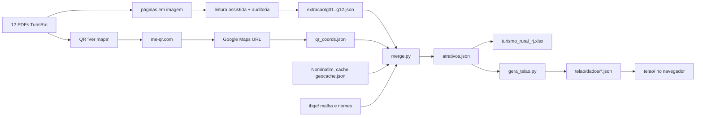
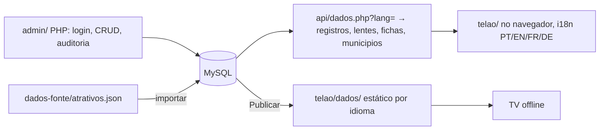

# ARCHITECTURE — como está construído hoje (16/10/2026)

Sem backend nem build. Duas partes: um **pipeline de dados** (Python) e um **app estático** (`telao/`, JS puro + three.js vendorizado).

## Pipeline (`dados-fonte/`)
- `extracao/` leitura dos guias, já corrigida pela auditoria (`auditoria.json`; `extracao/original/` guarda a leitura bruta).
- `processo/` scripts que leram os QR (`qr.py`, `qr2.py`) e os resolveram em coordenadas (`resolve*.py`); dependem dos PDFs e de rede e **não** fazem parte do gate (o resultado está em `qr_coords.json`). Fontes em `FONTES.md`.
- `merge.py`: casa QR↔atrativo **pela ordem na página** (só quando a contagem confere); aceita a coordenada do QR só se a URL do Google traz coordenada e o ponto cai a <12 km do município; QR repetido em 3+ atrativos vira "localidade" (aproximado); sem ponto → Nominatim pelo endereço (aceito se perto do município) → senão só o município. Classifica rotas/categorias/experiências por palavras-chave; gera a planilha e `atrativos.json`.
- `gera_telao.py`: converte para o formato do telão (plano local em km, grupos = rotas, lentes, fichas, regiões turísticas, divisas).
- `test_dados.py`: 15 testes de invariantes e regressões.

## App (`telao/`)
- `index.html` (CSP `default-src 'self'`), `estilo.css`, `cena.js` (um `iniciar()` com closures, ~1,7 mil linhas), `vendor/three` (r0.186, sem addons), `vendor/qr/qrcode.min.js` (QR offline), `dados/`.
- Dados lidos: `altura.bin/json` (relevo, Int16), `cobertura.png/json` (classes do MapBiomas), `municipios-3d.json` (polígonos em km, regiões, divisas), `registros.json` (`[x_km,y_km,rota,precisão,município,código,nome]` + agregados), `lentes.json` (Rotas/Quero…/Produtos), `fichas.json`.
- **Render:** malha sólida do relevo (1 vértice a cada 2 células; 3 em `q=baixa`; ~1 milhão de triângulos) com um fragment shader que pinta pela textura de cobertura (4 células vizinhas misturadas, borda entortada por ruído), sombra de relevo (luz de noroeste), mata/pasto/lavoura com ruído, mar raso→fundo com espuma, esmaecimento no papel creme e bruma de distância; destaque da seleção por textura de município. Limites municipais em `LineSegments` e contorno do estado tracejado. Atrativos = `THREE.Points` com atlas de gotas (ícone por rota), ponta ancorada no ponto, `alphaToCoverage`. Seleção = parede translúcida terracota/mostarda no contorno. MSAA ligado; sem pós-processamento.
- Interação: gestos próprios (arrastar, pinça, giro), raycast no relevo (`tocarRelevo`), alvos sob o toque por distância em tela (`alvosSob`, raio 26 px), etiquetas/ladrilhos em DOM sobrepostos, painéis (cartão, lista "o que tem aqui", ficha), passeio automático (`passoAtracao`), teclas (1/2/3, N, F, Esc, espaço).
- Ganchos de prova: `window.__telao` (`pronto`, `info`, `estado`, `projetar`, `ficha`, `abrir`) e `__telaoDepuracao`.
- `servidor.ps1` (HttpListener, só localhost, bloqueia saída da pasta) + `abrir-telao.bat` (Edge em quiosque).

## Testes e qualidade
`verificar.mjs` → sintaxe, `test_dados.py` e `telao/_provas/provas.mjs` (Chrome headless por CDP, sem dependências: cliques reais, ficha conferida contra os dados, QR decodificado da tela com OpenCV, passeio, servidor PowerShell, 4 tamanhos de tela, contraste; reprova em exceção, `console.error`, violação de CSP ou requisição externa). `.github/workflows/verificar.yml` roda o gate no GitHub (ainda não executado).

## Arquitetura proposta (F7–F10, ainda não implementada)

Decisões propostas: o banco é a fonte da verdade, e o pipeline Python vira só a **importação inicial**; o telão continua estático e passa a escolher a fonte (`api` online, `estatico` offline); idioma é parâmetro da API e do telão; traduções ficam em tabela própria com status; convenções do `mapa-3d` (PHP ≥ 8.2, PDO, `Mapa\` em `app/`, migrações numeradas, PHPUnit/PHPStan). Impacto: nenhum arquivo do telão é removido; `cena.js` troca textos fixos por `t()`; `gera_telao.py` continua válido para o modo offline até a exportação do admin substituí-lo.

## Débitos técnicos
1. `cena.js` monolítico. 2. A cobertura do solo tem células de 280 m: de perto a borda entre classes depende do ruído do shader (orgânico, mas não é dado real). 3. Casamento QR↔atrativo por ordem (mitigado: contagem igual + conferência de nome na URL, 0 trocas detectadas). 4. 161 atrativos sem coordenada. 5. Rotas por palavras-chave. 6. Provas dependem de Chrome; em Linux usam SwiftShader (lento). 7. Layout não pensado para celular.
